<div align="center">

# 玉阳洞天游园<br>Yuyang Dongtian Garden Walk

**Walk into a Ming handscroll.**

A free browser game that rebuilds the blue-and-green landscape scroll *Yuyang Dongtian* 玉阳洞天图卷,<br>
bearing the signature of Qiu Ying (Tianjin Museum), as one continuous 3D world you can wander and dwell in.

### [▶ Play in English](https://art.starverse.chat/?lang=en) &nbsp;·&nbsp; [▶ 进入中文版](https://art.starverse.chat/?lang=zh)

<sub>Desktop or phone · nothing to install, no account · Chinese and English · [中文说明 ↓](#中文说明)</sub>

<a href="https://art.starverse.chat/?lang=en">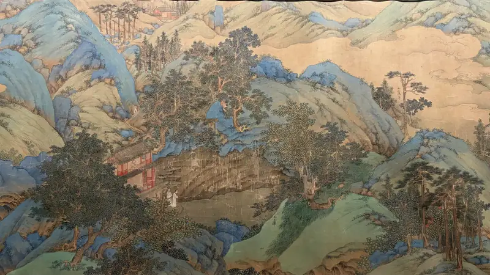</a>

<sub>The gallery photograph of the Jade Maiden Pool dissolves into the game's <i>painting view</i>, and the camera walks down into the scene.</sub>

</div>

---

The eleventh-century master Guo Xi prized landscapes one can *wander in and dwell in* (可游可居). This project takes him at his word. A handscroll is viewed a section at a time, right to left, as it unrolls; here every section becomes a place you can walk into. Each scene can be seen from the very angle its painter chose, with the photograph of the painting faded in on top, and then left behind for views the painter never drew.

<div align="center">

**13** scenes &nbsp;·&nbsp; **6** zones &nbsp;·&nbsp; one world about **770 m** long &nbsp;·&nbsp; **30+** figures to meet and play &nbsp;·&nbsp; a **24-minute** day

</div>

## The painting and the world

Every scene has a **painting view** (press <kbd>V</kbd> in the game): a camera fitted so that rocks, trees and halls fall where they are painted. Left, the gallery photograph (low resolution); right, the same scene rendered live in the browser. Six of the thirteen scenes, in visiting order from the head of the scroll:

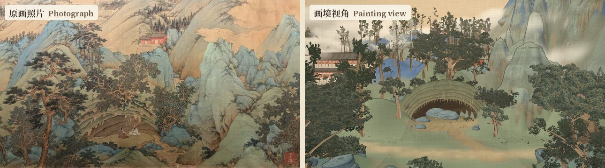

**金晶巖 · 龍王廟** Golden Crystal Cliff · Dragon King Temple. Where the walk begins: a grotto under stacked ledges, a temple in red walls above. *Zone 1.*

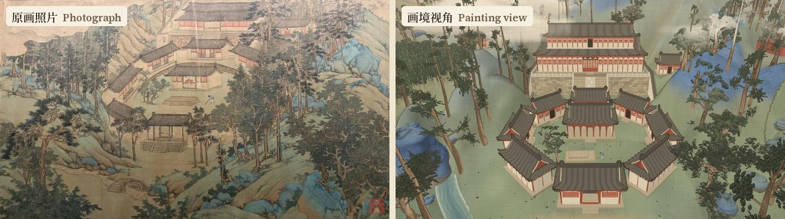

**隅九桥 · 大觀廊** Yujiu Bridge · Daguan Gallery. Trees hide most of the halls; the game reads them as eight halls in an octagon around an altar hall, below a palace on a stone terrace. *Zone 1.*

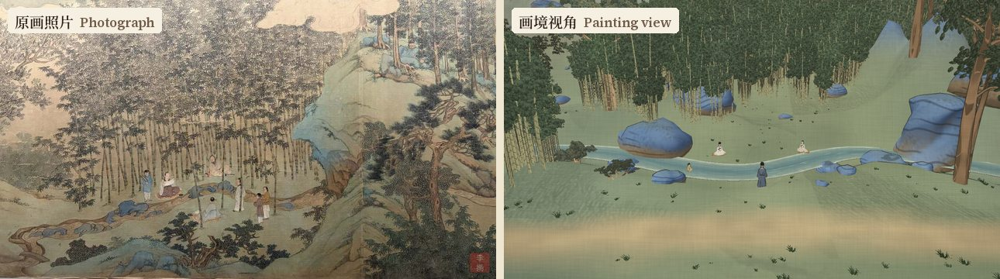

**流觴嶼** Isle of Floating Cups. Scholars gather by a winding stream below a bamboo grove. *Zone 2.*

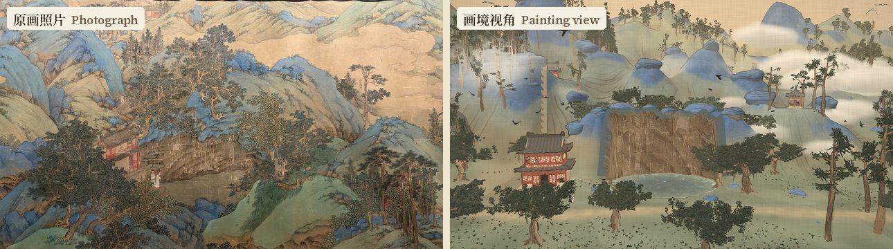

**玉光閣 · 玉女潭** Jade Light Tower · Jade Maiden Pool. A dark pool below a streaked cliff, where the game opens. *Zone 3.*

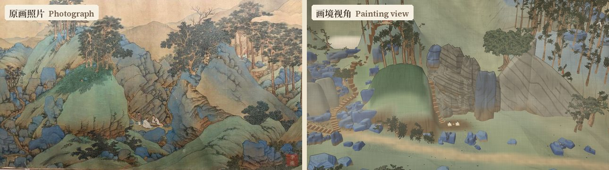

**磐玉隈** Jade Boulder Nook. Two men at chess under a great slanting rock, the Ethereal Pavilion on the round hill above. *Zone 4.*

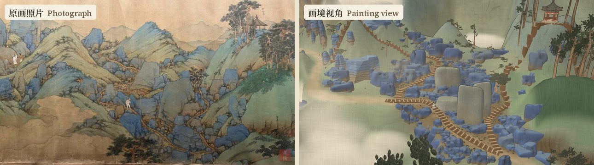

**琪樹峡** Qishu Gorge (the Gorge of Jasper Trees). About forty blue-green rocks, each placed from its outline in the photograph, with stone steps winding up through them. *Zone 4.*

## What you can do

- **Wander anywhere.** Walk the path or leave it, fly over ridges, rise above the clouds. <kbd>Tab</kbd> opens a route map of the whole scroll.
- **See it as painted.** <kbd>V</kbd> flies you to the painter's viewpoint; a slider then fades the photograph in over the 3D scene.
- **Meet the people in the painting.** Click a figure to read their story. <kbd>F</kbd> takes their place: walk up to others to talk, bow, walk together or sit together. One man leaning on a railing lends you his eyes.
- **Stay until nightfall.** A day lasts 24 minutes. At dusk lanterns glow under the eaves, river lamps drift on the pool, fireflies rise, and the figure you play carries a lantern.
- **Leave your name.** Travellers in China once carved their names on cliffs at famous sites. A stone screen by the Jade Maiden Pool is this garden's inscription wall.

<div align="center">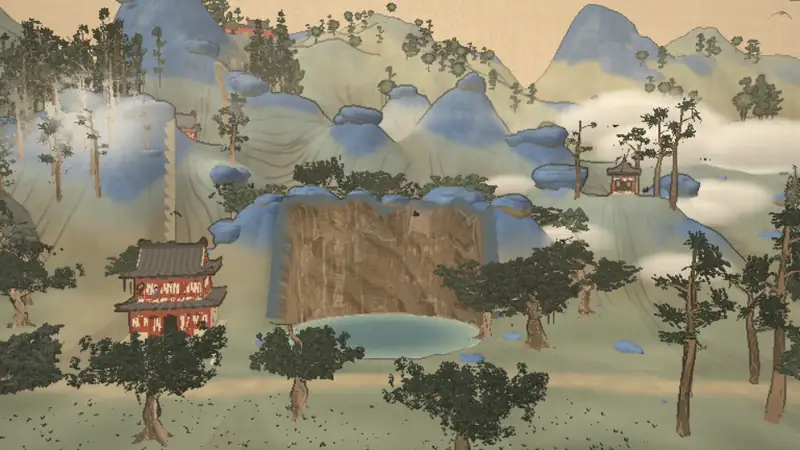</div>

<sub>The same painting view from mid-afternoon to nightfall. The painter showed one hour; the game keeps all twenty-four.</sub>

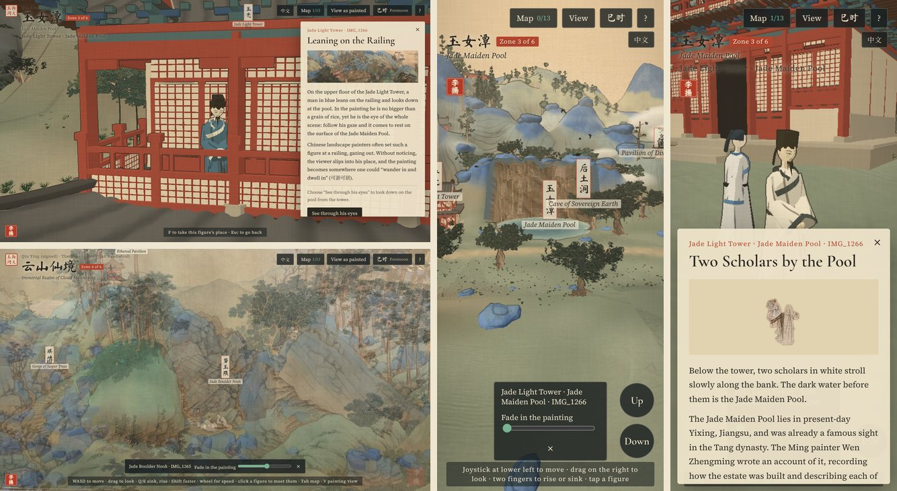

<sub>The English interface on desktop and phone. **Top left:** clicking the man at the railing opens his story. **Bottom left:** the photograph of Jade Boulder Nook half faded in over the painting view; the two chess players sit where they are painted. **Right:** the Jade Maiden Pool on a phone.</sub>

### Beyond the painter's frame

<p align="center">
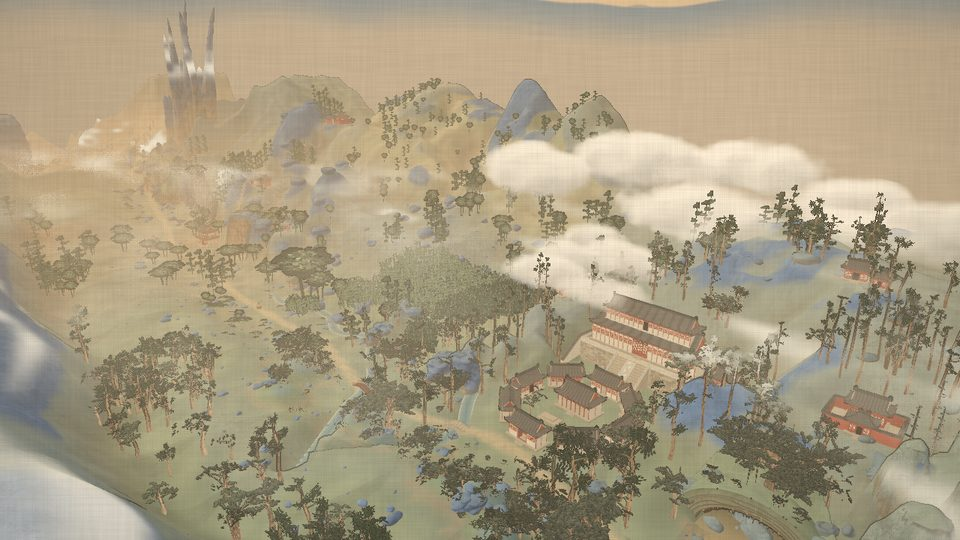
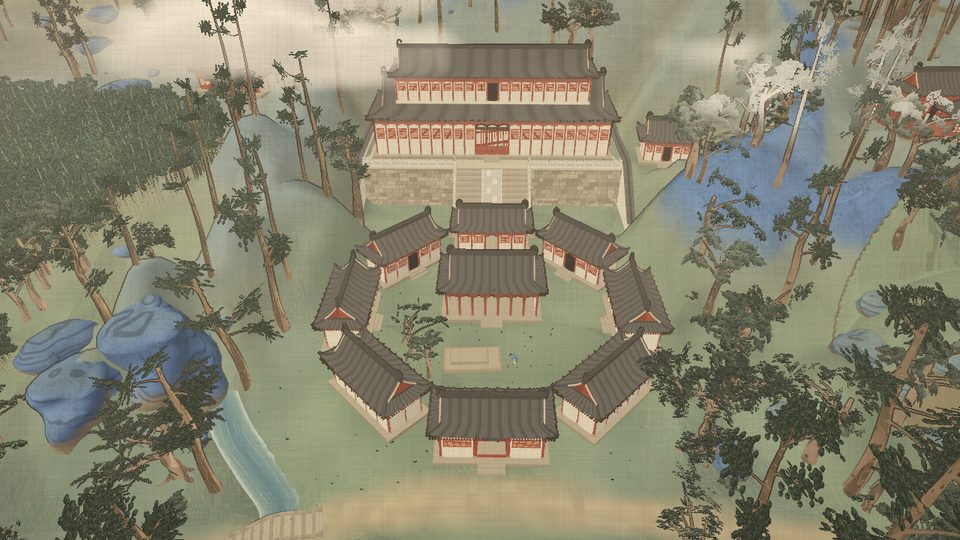
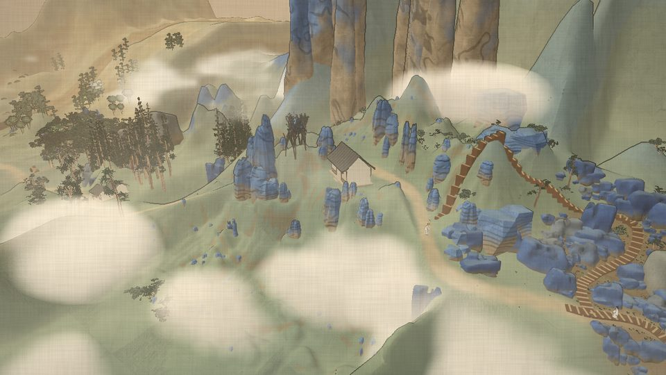
</p>

<sub>**Left:** one continuous world, with the Daguan Gallery in front and, far off, the stone pillars of Hibiscus City rising from the clouds. **Middle:** the Daguan Gallery's octagonal courtyard, which the painting only half shows. **Right:** Chaoran Pavilion and the steps of Qishu Gorge, from a height the painter never took.</sub>

<p align="center">
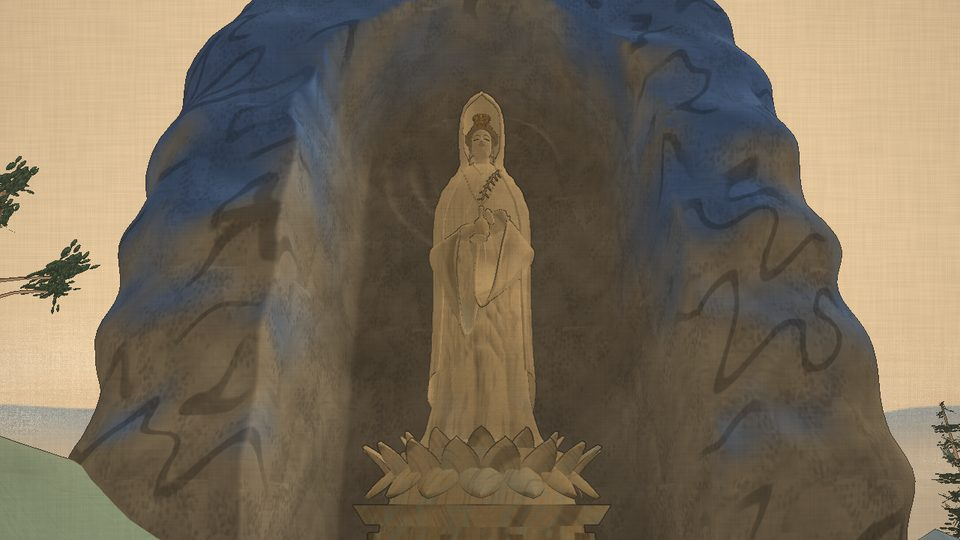
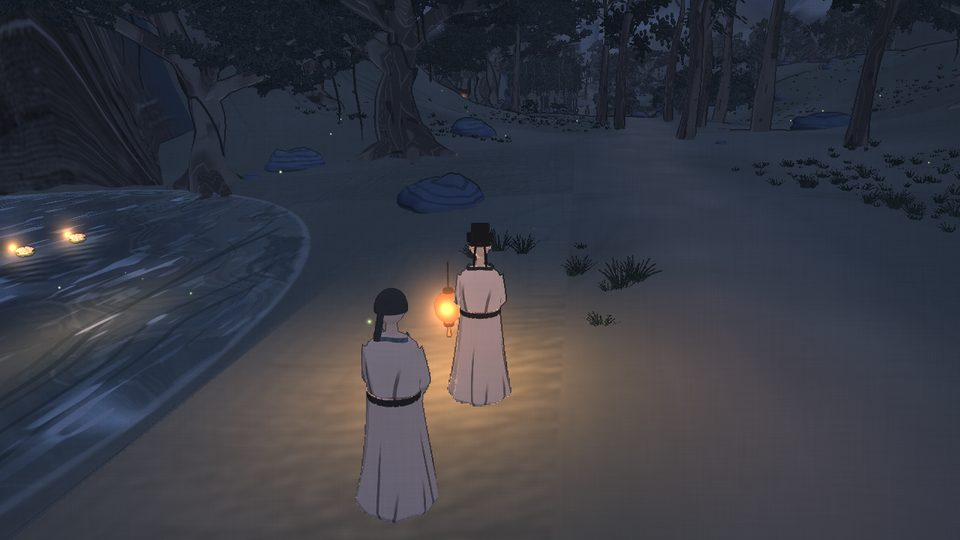
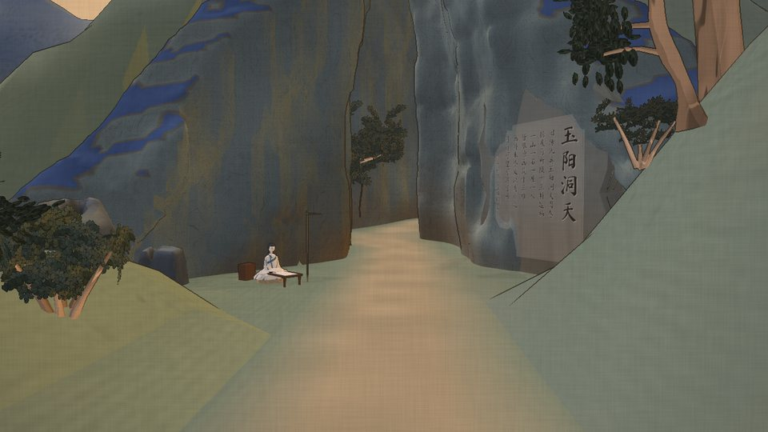
</p>

<sub>**Left:** a 35 m cliff-carved Guanyin in the manner of Longmen, an addition that is not in the painting. **Middle:** playing a scholar at night, lantern in hand, river lamps on the pool. **Right:** where the path ends, a terrace over a sea of clouds, a painter sketching at the edge and the makers' inscription on the cliff.</sub>

## How it was made

### Thirteen photographs, seven gaps

The only source is thirteen phone photographs that Yang Li took through the gallery glass at the Tianjin Museum on 19 July 2026, all within five minutes. Re-photographing was impossible. Five of the twelve seams between photographs overlap and were stitched; the other seven have no overlap and were **imagined in the painting's idiom**. They are marked as such, not hidden.

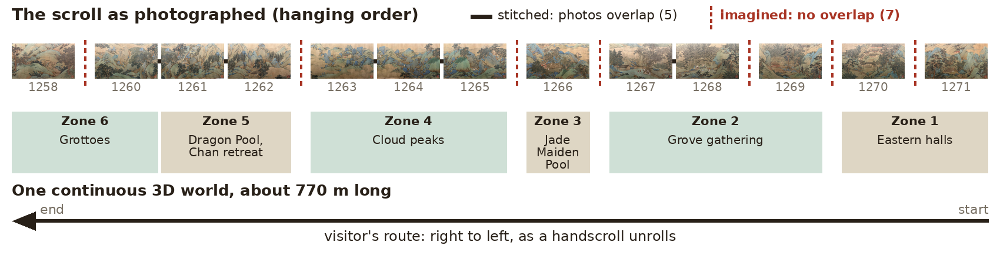

### Back-projecting the painter's views

For each scene, a painting-view camera is fitted so that a few landmarks land on their painted pixels. Every painted rock, tree and building is then read off a gridded copy of the photograph and placed by casting a ray from the camera through its foot onto the terrain; its top gives its height. Qishu Gorge alone has about forty rocks placed this way. Each round is checked by laying the photograph over a render from the same angle:

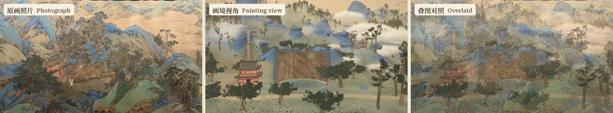

This also shows why a scroll is not a photograph. No single pinhole camera fits its shifting perspective, so the world folds its foregrounds into steep terraces and "cheats" the way the painter did.

### Everything is code

- **No engine, no build step.** Plain ES modules on [three.js](https://threejs.org/) r170, about 9,000 lines of JavaScript. Serve the folder over HTTP and it runs.
- **Procedural all the way down.** Halls are assembled from bases, brackets, rafters, tiled roofs and lattice doors in the Ming manner. Rocks are carved from distance fields, with ink-lined cracks. Trees carry ink-outlined leaf clusters; distant trees become a few brushstrokes on a card. Clouds are raymarched in a post-processing pass.
- **A painterly renderer.** Shaders add silk weave, mineral blues and greens sampled from the painting, ink contours and mist. As in the painting, there are no cast shadows and no realistic lighting.
- **One sculpted head.** The Guanyin's head was modelled in Python as a signed distance field (about 1.5 million triangles), compared over seven rounds of same-angle renders with photographs of a wooden Water-Moon Guanyin in the National Museum of China, then reduced in Blender to 60,000 triangles for the browser.
- **Light enough for a phone.** Desktop and phone get different levels of detail, and the heaviest terrain and rock computations are baked into `assets/world_bake.txt`.

### A human and an AI, under one seal

**Yang Li (李揚)**, an independent artist, photographed the scroll, set the aims and judged every version against the photographs. **Claude**, an AI model by Anthropic working as a coding agent, wrote essentially all of the code, modelled the assets, laid out the scenes and rendered same-angle comparisons for every round. The work took about a month (24 October to 23 November 2026) and 55 numbered versions.

The scroll itself is a *Suzhou pian*, a Suzhou workshop painting sold under Qiu Ying's famous name, so its authorship was plural from the start. The game is signed the same way, openly: 李揚與Claude同製, "made together by Yang Li and Claude".

Three lessons from the process:

1. **Show, don't tell.** When the AI followed spoken notes on the Guanyin's face literally, the face got worse. Comparing renders with the photograph at the same angle fixed it. In Yang's words, "a picture beats a thousand words".
2. **Atmosphere comes from layout.** The painting's *yijing* (意境) came from sightlines, open slopes and mist more than from model detail, so the scenes were refined together in rounds, "like tightening screws", rather than one at a time.
3. **Visitors join the loop.** After release, a visitor's remark that the Jade Maiden Pool looked thin led to new mountains behind it.

No image generator was used. Every picture on this page is either a screenshot of the running game or the author's photograph of the painting, shown at low resolution. Development used over five million tokens of AI-generated text; we note the energy cost this implies.

### What comes from the painting, and what does not

In the spirit of the London Charter for computer-based visualisation of cultural heritage, the game discloses its conjectures and additions instead of passing them off as the painter's.

| From the painting | Imagined where the painting is silent | Added, and disclosed as additions |
|---|---|---|
| The layout, halls, rocks, trees and figures of all thirteen scenes, placed by back-projection and checked against the photographs | The seven seams with no photographic overlap; whatever lies behind hills and inside courtyards the painter did not show (the Daguan Gallery's octagon is a reading of halls half hidden by trees) | A 35 m cliff-carved Guanyin in the manner of Longmen; a waterfall pool with a boat opposite the Dragon Pool; the cloud terrace at the scroll's end, with a painter and the makers' inscription; the inscription wall; night, lanterns and river lamps |

## Controls

| | Desktop | Phone |
|---|---|---|
| Move | <kbd>W</kbd><kbd>A</kbd><kbd>S</kbd><kbd>D</kbd> or arrow keys · <kbd>Q</kbd>/<kbd>E</kbd> down and up · <kbd>Shift</kbd> faster | Hold the lower left for a joystick · two fingers up or down to rise and sink |
| Look around | Drag with the mouse | Drag on the right |
| Painting view | <kbd>V</kbd> | **View as painted** |
| Route map | <kbd>Tab</kbd> | **Map** |
| Time of day | <kbd>T</kbd> | Hour button, top right |
| Play a figure | Click a figure, then <kbd>F</kbd>; <kbd>E</kbd> to interact | Tap a figure, then **Take his place**; **Act** to interact |
| All controls | <kbd>H</kbd> | |

## Run it locally

It is a static site with no build step. Because it uses ES modules, serve it over HTTP rather than opening the file directly:

```sh
git clone https://github.com/cookyecat/yuyang-dongtian.git
cd yuyang-dongtian
python3 -m http.server 8000
# then open http://localhost:8000/?lang=en
```

Any current browser with WebGL 2 will do. `?lang=en` or `?lang=zh` picks the language; otherwise it follows the browser.

<details>
<summary><b>Repository layout</b></summary>

```text
index.html         page, interface and intro (Chinese and English side by side)
js/main.js         game loop, cameras, figures, scenes
js/world.js        terrain height field, route, water levels
js/art.js          painterly materials and post-processing: silk, pigments, ink lines, mist, clouds
js/props.js        scene objects: main peaks, cliffs, trees, bridges, steps
js/buildings.js    Ming-style halls assembled from parts
js/zone1.js        Eastern Reach: Golden Crystal Cliff, Dragon King Temple, Daguan Gallery
js/zone2.js        Cloud Mountains: great boulders and the rocks of Qishu Gorge
js/rockgen.js      distance-field rocks (also run in a Web Worker, rockworker.js)
js/fartrees.js     distant trees drawn as brushstroke cards
js/figures.js      the figures, their dress and poses
js/crane.js        cranes; js/birds.js the flocks in the sky
js/guanyin.js      the Guanyin statues and the cliff niche
js/water.js        pools, streams and the waterfall
js/daynight.js     day and night, lanterns, river lamps, moon, fireflies
js/credit.js       colophon, cliff inscription, inscription wall
js/i18n.js         language switch; js/lang_en.js holds the English text
js/bake.js         reads the baked data in assets/world_bake.txt
assets/            textures, the Guanyin head, low-resolution photographs, baked data
guestbook/         inscription-wall backend (Cloudflare Workers + D1)
tools/bake.cjs     regenerates assets/world_bake.txt after any change in js/
docs/media/        images for this README
LICENSE            MIT, for the code; LICENSE-CC-BY-4.0 for original non-code content
NOTICE.md          which files fall under which licence, and which are not licensed
```

After editing anything in `js/`, run `node tools/bake.cjs .` before publishing. Otherwise the stale bake is ignored and the page computes everything while loading (same result, slower).

</details>

## Credits and sources

- **Original work:** *Yuyang Dongtian tu* 玉阳洞天图卷, handscroll, bearing the signature of Qiu Ying (仇英, d. 1552). Tianjin Museum.
- **Photographs:** taken by the author in the museum gallery. Only low-resolution copies are published, so the game can show the painting beside its 3D world. They are not covered by this repository's licences (see [License](#license)).
- **Rendering:** [three.js](https://threejs.org/) r170 (MIT License, see `vendor/three/LICENSE`).
- **Inscription wall backend:** Cloudflare Workers + D1; code and setup in `guestbook/`.
- **Fonts** (all SIL Open Font License 1.1, subset to the characters used; see `fonts/OFL.txt`): Ma Shan Zheng and Noto Serif SC; LXGW WenKai TC for the signature and seals only; Source Serif 4 and Cormorant Garamond for the English interface.

**Made by** Yang Li 李揚 with Claude · GitHub [@cookyecat](https://github.com/cookyecat) · X [@myannli](https://x.com/myannli)

## License

- **Code** (`index.html`, `js/`, `tools/`, `guestbook/` and the rest of the source): [MIT License](LICENSE).
- **Original non-code content** (this README, the screenshots and animations of the game, the Guanyin head model): [CC BY 4.0](LICENSE-CC-BY-4.0). Credit it as *Yuyang Dongtian Garden Walk* by Yang Li, made with Claude (Anthropic).
- **Third-party parts** keep their own licences: three.js (MIT) and the fonts (SIL Open Font License 1.1).
- **Not licensed:** the photographs of the painting taken in the Tianjin Museum, and every image cut from them, are excluded from both licences, and no permission to reuse them is granted. That covers `assets/painting_*.jpg`, the painted textures and figure cards in `assets/`, and the painting side of the comparison images on this page. The full list is in [NOTICE.md](NOTICE.md).

Both licences allow commercial use, with credit.

## Citing

A short paper on this work, *A Landscape to Wander and Dwell In: Rebuilding the Ming Handscroll* Yuyang Dongtian *as a Walkable World with an AI Collaborator*, was written for DH2027 (Digital Art(s) track). To cite the game itself:

```bibtex
@software{li_2026_yuyang_dongtian,
  author = {Li, Yang},
  title  = {Yuyang Dongtian Garden Walk (玉阳洞天游园)},
  year   = {2026},
  url    = {https://art.starverse.chat/},
  note   = {Made with Claude (Anthropic);
            code at https://github.com/cookyecat/yuyang-dongtian}
}
```

---

<a id="中文说明"></a>

## 中文说明

**走进一幅明代手卷。** 「玉阳洞天游园」据仇英（款）《玉阳洞天图卷》（天津博物馆藏）复原，把整卷青绿山水做成浏览器里一个连续的 3D 世界：可以自由游览，点人物看故事，接管画中人与他人互动，看昼夜流转。

**[▶ 进入游园](https://art.starverse.chat/?lang=zh)** · 电脑、手机都能玩，无需安装、无需注册，中英文界面随时切换。

### 看点

- **六区十三景连成一张地图**：全长约 770 米，按手卷惯例自右向左，从卷首金晶巖一路走到卷尾四陽洞。
- **画境视角**：每一景都有一个画境镜头（按 <kbd>V</kbd>），照原画反投影定位，山石、树木、殿阁落在原画的位置；拖动滑条，原画照片就叠在 3D 场景上。上面的对照表就是各景的原画与画境视角。
- **画中人**：三十多个人物都照原卷重做。点人物看介绍，按 <kbd>F</kbd> 接管他，走到别人身边交谈、作揖、同行、邀坐；玉光閣上凭栏的人，还能借你他的眼睛。
- **昼夜流转**：一日 24 分钟。入夜殿亭檐下点起灯笼，玉女潭漂着河灯，萤火、月亮和星，接管的人手提灯笼。
- **题名壁**：古人游山爱在石壁上留名。玉女潭玉光閣西边路旁的石屏就是题名壁，游人可以留下名字。

### 怎么做的

- **只有十三张照片**：原画是作者 2026 年 7 月 19 日在天津博物馆隔着展柜玻璃用手机拍的，五分钟内拍完，无法补拍。十二处接缝里五处有重叠、直接拼接；七处没有重叠，按原画笔意想象补完，并明确标出。
- **画境反投影**：每一景先拟合一个画境镜头，让几个标志点落在原画的位置；再把画中每块石、每棵树、每座房子从带网格的照片上读出来，从镜头穿过它的脚点向地形发射线定位，顶点给出高度。仅琪樹峡就有约四十块石头是这样一块块摆上去的。每一轮都把原画叠在同角度渲染上核对。这也说明手卷不是照片：没有哪个针孔镜头能同时满足它的散点透视，所以前景只能折成陡峭的层叠坡，像画家那样"作弊"。
- **全部是代码**：three.js r170，纯 ES 模块，无构建步骤，约九千行 JavaScript。明式殿阁按构件程序化拼装，嶙峋石用距离场雕，树叶团勾墨线，远树是几笔画片，云在后处理里光线步进；着色器做绢纹、取自原画的矿物色、墨线和雾，不做写实光影。观音头像用 Python 距离场建模（约 150 万面），对照国家博物馆木雕水月观音的照片同角度比了七轮，再在 Blender 里减到 6 万面放进浏览器。
- **人机合作**：李揚拍摄原画、定方向，每一版都对着原画判断好坏；Claude（Anthropic 的 AI 模型，作为编程代理）写了几乎全部代码，建模、布景，每一轮出同角度对照图。前后约一个月（2026 年 10 月 24 日至 11 月 23 日），55 个版本。原画本是"苏州片"，托仇英之名、出自无名画工之手；这座游园也明白署名：「李揚與Claude同製」。
- **三点体会**：一图胜千言，照文字改不如对着原图同角度比；意境来自布局、视线和雾，不在模型多精细，所以各景"拧螺丝"式轮流打磨；游人也参与进来，粉丝说玉女潭单薄，潭后就添了山。
- 本页所有图片都是游戏实时渲染的截图或作者拍的原画照片（低清），没有用 AI 生图。

### 哪些来自原画，哪些不是

- **来自原画**：十三景的布局、殿阁、山石、树木和人物，按反投影摆放并对照原画核对。
- **原画没画、按笔意想象的**：七处无重叠的接缝；山后、院内等原画看不到的部分（大觀廊的八合院是对被树遮住的一圈殿宇的解读）。
- **另外添加、明确标出的**：仿龙门的 35 米摩崖观音；龍湫对面的瀑布深潭和小船；卷尾的望云台、写生画师和作者题刻；题名壁；夜景、灯笼和河灯。

### 操作

- 电脑：WASD 移动，Q/E 升降，Shift 加速，按住鼠标拖动转向；Tab 游线图，V 画境视角，T 拨时辰，点人物后 F 接管、E 互动，H 查看全部操作。
- 手机：左下按住出摇杆，右侧拖动转向，双指上下拖动升降。
- 中英文：右上角 EN / 中文 按钮切换；默认按浏览器语言（偏好里有中文就中文，否则英文），选过一次会记住。链接加 `?lang=en` 直接打开英文版，`?lang=zh` 中文版。英文文案在 `js/lang_en.js`（地名、人物、台词）和 `index.html` 里 `class="en"` 的段落。

### 本地运行

纯静态网站，没有构建步骤。因为用了 ES 模块，需要通过 HTTP 打开，不能直接双击 `index.html`：

```sh
python3 -m http.server 8000
# 浏览器打开 http://localhost:8000
```

改了 `js/` 里的任何文件，发布前要跑 `node tools/bake.cjs .` 重新生成 `assets/world_bake.txt`（不跑也能用，只是载入时现场算，慢一些）。题名壁后端在 `guestbook/`，部署步骤见那里的 README。

### 来源与致谢

- 原作：仇英（款）《玉阳洞天图卷》，天津博物馆藏。
- 原画照片：作者在博物馆展厅实拍。公开仓库里只放低清版本，用于游戏中与原画对照，不在本仓库的许可范围内（见下方「许可」）。
- 渲染：[three.js](https://threejs.org/) r170（MIT 许可，见 `vendor/three/LICENSE`）。
- 题名壁后端：Cloudflare Workers + D1，代码和部署步骤在 `guestbook/`。
- 字体：马善政楷书 Ma Shan Zheng、思源宋体 Noto Serif SC；落款和印章用霞鹜文楷 TC（只含落款用字）；英文界面用 Source Serif 4 和 Cormorant Garamond。均为 SIL Open Font License 1.1，已按本作用字子集化，许可全文见 `fonts/OFL.txt`。

**作者**：李揚 YANG LI 与 Claude · GitHub [@cookyecat](https://github.com/cookyecat) · X [@myannli](https://x.com/myannli)

### 许可

- 代码（`index.html`、`js/`、`tools/`、`guestbook/` 等全部源代码）：[MIT 许可](LICENSE)。
- 原创的非代码内容（本 README、游戏截图与动图、观音头像模型）：[CC BY 4.0](LICENSE-CC-BY-4.0)。署名请写：《玉阳洞天游园》，李揚 与 Claude（Anthropic）同制。
- 第三方组件沿用各自的许可：three.js（MIT），字体（SIL Open Font License 1.1）。
- **不在许可范围内**：在天津博物馆拍摄的原画照片，以及从照片裁出的一切图像，既不适用 MIT，也不适用 CC BY 4.0，本仓库不授予任何再使用的许可。包括 `assets/painting_*.jpg`、`assets/` 里取自原画的贴图和人物卡片、本页对照图里原画那一侧。完整清单见 [NOTICE.md](NOTICE.md)。

两种许可都允许在署名的前提下商用。
